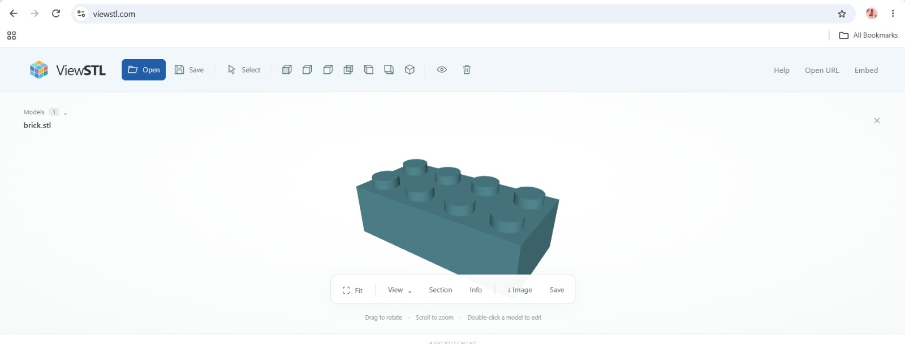
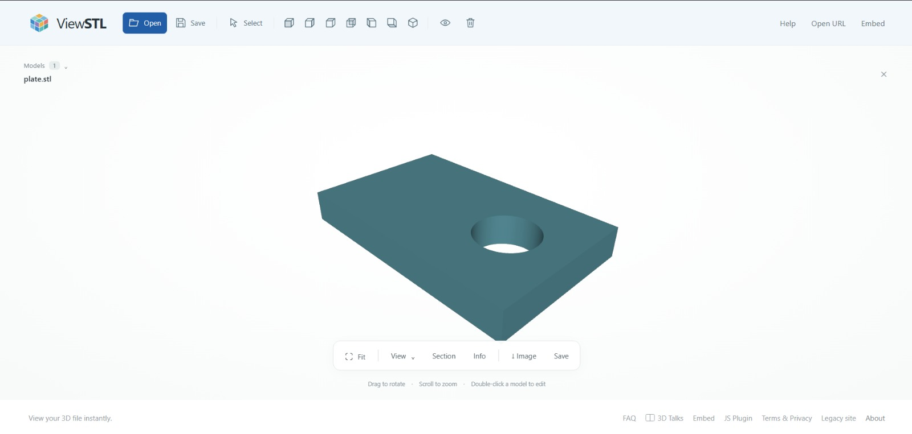

# IMS-AI | CAD Modelling Portfolio

**Name:** Aman Patnaik  
**Registration Number:** 2302110041

This repository showcases two parametric CAD models developed using Python and CadQuery. The models were exported in STL format, and their final geometries were captured for visual documentation.

---

## 1. Brick Model

- **Python Code (`brick.py`):** Developed the parametric brick model using CadQuery.
- **STL File (`brick.stl`):** Exported the completed 3D model in STL format.
- **Screenshot:** Visual representation of the final brick geometry.

---

## 2. Plate Model

- **Python Code (`plate.py`):** Developed the parametric plate model using CadQuery.
- **STL File (`plate.stl`):** Exported the completed 3D model in STL format.
- **Screenshot:** Visual representation of the final plate geometry.

---

## Repository Contents

| File | Description |
|---|---|
| `brick.py` | Brick modelling code |
| `brick.stl` | Brick 3D model |
| `brick.png` | Brick screenshot |
| `plate.py` | Plate modelling code |
| `plate.stl` | Plate 3D model |
| `plate.png` | Plate screenshot |

---

**Tools Used:** Python | CadQuery | GitHub

*This repository documents the CAD modelling and version-control activities completed as part of the IMS-AI learning programme.*
