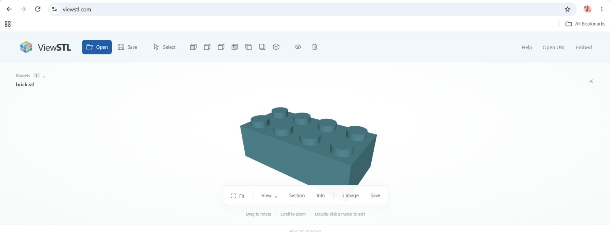
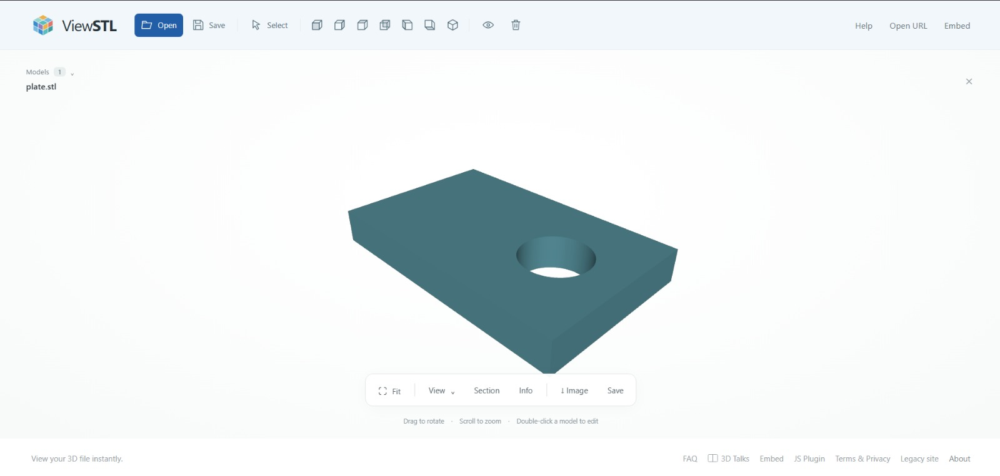

# IMS-AI CAD Portfolio

**Name:** Aman Patnaik

This repository contains two CAD models developed using Python and CadQuery.

## 1. Brick Model

- **brick.py:** Python code developed to create the parametric brick model.
- **brick.stl:** STL file exported for the 3D brick model.
- **brick.png:** Screenshot displaying the final brick model.

## 2. Plate Model

- **plate.py:** Python code developed to create the parametric plate model.
- **plate.stl:** STL file exported for the 3D plate model.
- **plate.png:** Screenshot displaying the final plate model.

## Repository Structure

    IMS-AI
    |
    |-- brick.py
    |-- brick.stl
    |-- brick.png
    |
    |-- plate.py
    |-- plate.stl
    |-- plate.png
    |
    |-- README.md